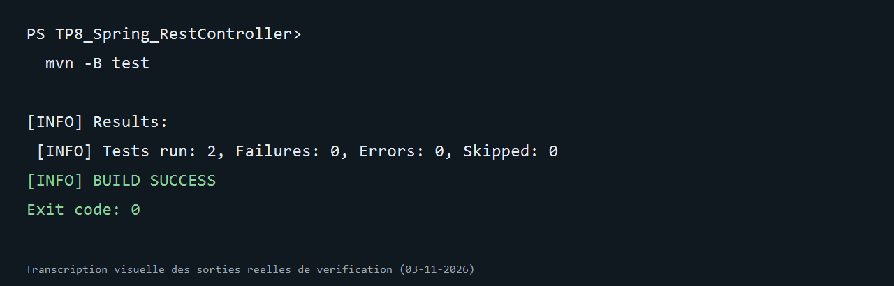

# TP8 — Spring `@RestController`

Projet du [TP 8 du cours Architecture Microservices](https://mliaedu.toubkalit.com/student/courses/7/labs/162). Il reprend la gestion des comptes bancaires avec Spring MVC, Spring Data JPA, H2, Swagger et les réponses JSON/XML.

## Démarrer

Prérequis : JDK 17 et Maven 3.6+.

```sh
mvn clean test
mvn spring-boot:run
```

- API : <http://localhost:8082/banque/comptes>
- Swagger UI : <http://localhost:8082/swagger-ui.html>
- OpenAPI : <http://localhost:8082/v3/api-docs>
- Console H2 : <http://localhost:8082/h2-console> avec `jdbc:h2:mem:banque`, utilisateur `sa`, mot de passe vide

Trois comptes de démonstration sont ajoutés au démarrage.

## Routes

| Méthode | Route | Réponse |
| --- | --- | --- |
| GET | `/banque/comptes` | Liste JSON ou XML |
| GET | `/banque/comptes/{id}` | Compte ou 404 |
| POST | `/banque/comptes` | 201 avec en-tête `Location` |
| PUT | `/banque/comptes/{id}` | Compte modifié ou 404 |
| DELETE | `/banque/comptes/{id}` | 200 ou 404 |

Les en-têtes `Accept` et `Content-Type` choisissent JSON ou XML. Exemple :

```sh
curl -H "Accept: application/xml" http://localhost:8082/banque/comptes
```

Les tests d'intégration utilisent H2 et MockMvc pour vérifier les deux formats, la création, le cas absent et le document OpenAPI.

## Résultat vérifié

Commande exécutée le 3 novembre 2026 :

```powershell
mvn -B test
```

2 tests d’intégration de l’API REST réussis avec H2 (0 échec).



L’image est une transcription visuelle de la sortie réelle de vérification ; la capture native de la fenêtre du terminal n’était pas disponible dans cet environnement.
